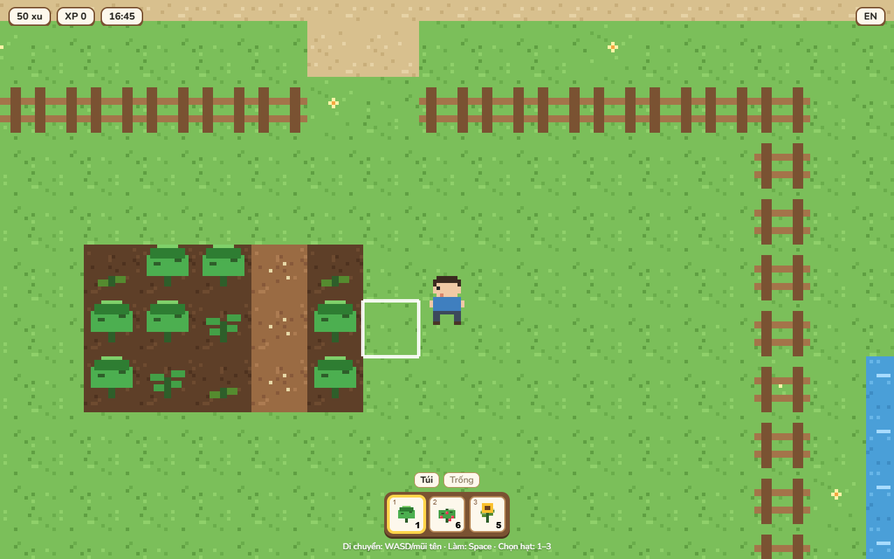
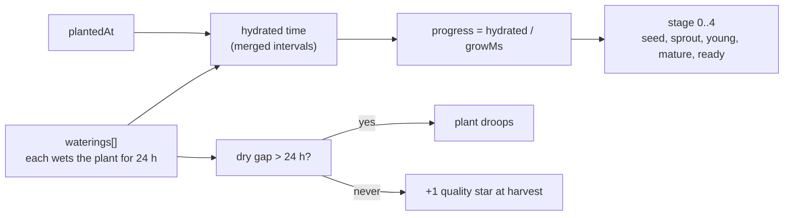

<div align="center">

# 🌱 Vườn Chung

**Một khu vườn nhỏ ấm áp để hai người cùng chăm — trồng, tưới, thu hoạch, và vườn vẫn lớn khi bạn ngoài đời.**

**A cozy pixel-art garden for two — plant, water, harvest, and the garden keeps growing while you are away.**

[](https://github.com/pdz1804/vuon-chung/actions/workflows/ci.yml)
[](https://github.com/pdz1804/vuon-chung/actions/workflows/codeql.yml)
[](LICENSE)
[](https://www.typescriptlang.org/)
[](https://phaser.io/)



</div>

> **Status:** wave 1 (solo farming core) is playable. The shared two-player world is [on the roadmap](#roadmap).

## Features

- **Farm loop**: till soil, plant seeds, water, harvest, ship to the bin, buy more seeds at Cô Ba's stall.
- **Real-time growth** that keeps going while you are offline, derived from timestamps instead of timers.
- **Care matters**: plants only grow while hydrated, droop when left dry, and well-cared crops earn a higher
  star quality (worth more coins).
- **Three crops** with different rhythms: rau muống (quick), strawberry (regrows), sunflower (slow, valuable).
- **Day and night** following Vietnam time (UTC+7), and a shipping bin that pays out at midnight.
- **Vietnamese and English** UI, switchable in-game.
- **Desktop and phone**: keyboard controls, or an on-screen joystick and action button on touch devices.
- **Crisp pixel art**, drawn procedurally at startup, so there are no image assets to download.

## How to play

| Action                            | Keyboard                  | Touch                          |
| --------------------------------- | ------------------------- | ------------------------------ |
| Move                              | `W` `A` `S` `D` / arrows  | Virtual joystick (bottom left) |
| Use the tile you face (see below) | `Space` or `E`            | Action button                  |
| Pick seed                         | `1` `2` `3`               | Tap a hotbar slot              |
| Close the shop                    | `Esc`                     | Close button                   |
| Switch language                   | Language pill (top right) | Language pill                  |

The action button does the sensible thing for the tile in front of you:

1. Empty soil in the fenced field: **till** it.
2. Tilled and empty: **plant** the selected seed.
3. Dry plant: **water** it. One watering keeps a plant hydrated for 24 hours.
4. Ripe plant: **harvest** it.
5. Next to the shipping bin: **ship** everything in your bag. It is paid out at the next midnight (Vietnam time).
6. Next to Cô Ba's stall: **open the shop** and buy seeds.

## How the growth simulation works

There is no game loop ticking crops. Every crop stores only _when it was planted_ and _when it was watered_.
Its stage is computed from those timestamps whenever the game needs to draw or act, so a farm that nobody
opened for three days is still exactly right when you come back.



Only hydrated time counts toward growth, so skipping a day delays a crop instead of ruining it. A crop that is
never dry for longer than 24 hours between planting and ripeness earns a second star. Strawberries stay in the
soil after harvest and regrow faster. See [docs/architecture.md](docs/architecture.md) for details.

## Tech stack

| Area      | Choice                                                                  |
| --------- | ----------------------------------------------------------------------- |
| Game      | [Phaser 3](https://phaser.io/) (arcade physics, pixel-art rendering)    |
| Language  | TypeScript 5.8 (strict)                                                 |
| Tooling   | Vite 6, Node 24                                                         |
| Unit test | Vitest 3 with V8 coverage                                               |
| E2E test  | Playwright (desktop and phone viewports)                                |
| Quality   | ESLint 9 (typescript-eslint, type-aware), Prettier 3                    |
| Workflow  | Husky 9, lint-staged, commitlint (conventional commits), GitHub Actions |
| Planned   | Firebase (Auth, Firestore, Realtime Database, Hosting)                  |

## Project structure

```text
vuon-chung/
├── src/
│   ├── sim/            Pure game rules: growth, farm actions, species data (+ unit tests)
│   ├── game/           Phaser scene, procedural textures, world map
│   ├── ui/             DOM overlay: status bar, hotbar, bag, shop, touch controls
│   ├── clock.ts        Game clock and the ?speed= dev clock
│   ├── save.ts         Local save (localStorage)
│   ├── i18n.ts         Vietnamese and English strings
│   └── main.ts         Phaser bootstrap
├── tests/e2e/          Playwright specs
├── docs/               Architecture notes and media
├── .github/            CI, CodeQL, dependency review, secret scan, templates
└── public/             Static assets (favicon)
```

## Roadmap

| Wave | Focus                                                                                      | Status   |
| ---- | ------------------------------------------------------------------------------------------ | -------- |
| 1    | Solo core: map, movement, till/plant/water/harvest, shop, bin, local save, i18n            | Done     |
| 2    | Professional repo: lint, format, hooks, CI, security scanning, docs                        | Done     |
| 3    | **Shared world**: Firebase Auth, create/join with an invite code, Firestore world, avatars | Upcoming |
| 4    | Time and economy: seeded rain, day/night polish, payout-once across clients, daily orders  | Upcoming |
| 5    | **Couple layer**: both-hands bonus, activity feed, while-away card, mailbox, memory tree   | Upcoming |
| 6    | Animals: chickens, feeding, petting, eggs, duo orders, emotes                              | Upcoming |
| 7    | Deploy: Firebase Hosting and deploy workflow, two-account e2e in CI                        | Upcoming |
| 8+   | Roles and ranks, kitchen, more crops and animals, festivals, mini-games, PWA push          | Later    |

## Development

Requires Node 24 and npm 11.

```bash
npm ci
npm run dev        # http://localhost:5240
```

Crops take hours, so use the dev clock: open `http://localhost:5240/?speed=3600` and one real second is one
game hour (with its own save slot). Add `#qa` to expose `window.__qa` for tests.

## Testing

```bash
npm test               # unit tests (Vitest)
npm run test:coverage  # with coverage
npm run test:e2e       # Playwright, desktop + phone
npm run check          # format:check, lint, typecheck, unit tests, build
```

Git hooks run lint-staged on commit, commitlint on the message, and typecheck plus unit tests on push.
See [CONTRIBUTING.md](CONTRIBUTING.md) for the full workflow.

## Contributing and security

Contributions are welcome: read [CONTRIBUTING.md](CONTRIBUTING.md) and the [Code of Conduct](CODE_OF_CONDUCT.md).
Report vulnerabilities privately as described in [SECURITY.md](SECURITY.md).

## License

[MIT](LICENSE) © 2026 Nguyen Quang Phu

---

<div align="center">

Phu Nguyen — HCMC, VN

</div>
