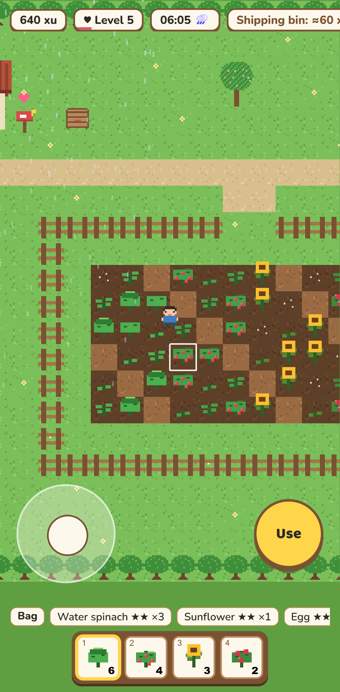
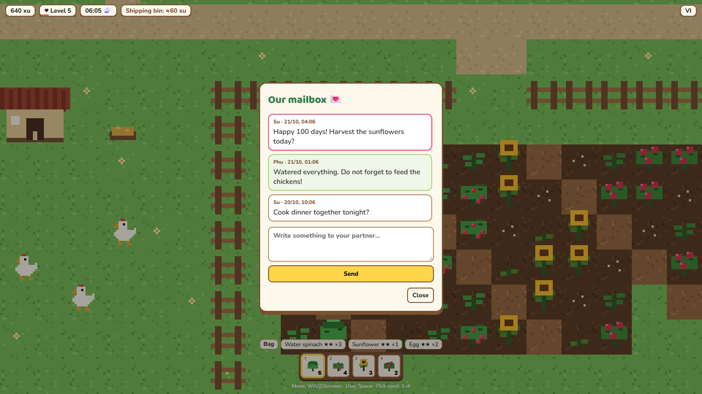
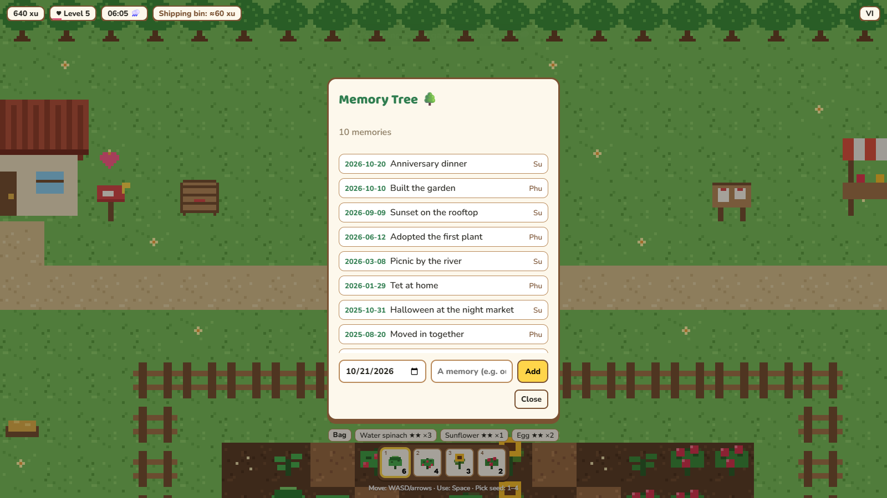
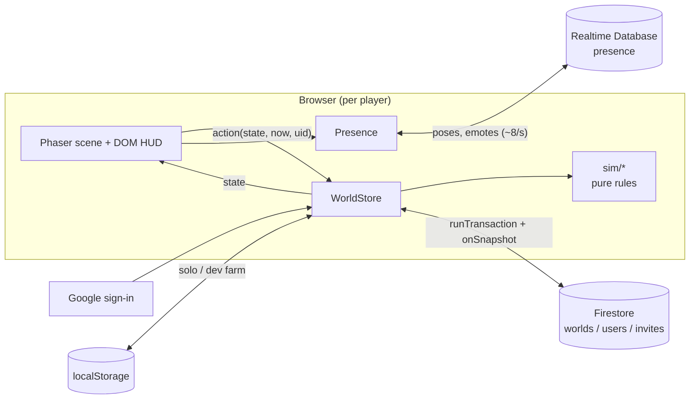

<div align="center">

# 🌱 Vườn Chung

**Một khu vườn nhỏ ấm áp để hai người cùng chăm — trồng, tưới, thu hoạch, và vườn vẫn lớn khi bạn ngoài đời.**

**A cozy pixel-art garden for two — plant, water, harvest, and the garden keeps growing while you are away.**

[](https://github.com/pdz1804/vuon-chung/actions/workflows/ci.yml)
[](https://github.com/pdz1804/vuon-chung/actions/workflows/deploy.yml)
[](https://github.com/pdz1804/vuon-chung/actions/workflows/codeql.yml)
[](LICENSE)
[](https://www.typescriptlang.org/)
[](https://phaser.io/)

### [▶ Play it: vuon-chung.web.app](https://vuon-chung.web.app)


<table>
  <tr>
    <td align="center"><br /><sub>Phone: joystick and Use button</sub></td>
    <td align="center"><br /><sub>The mailbox</sub></td>
    <td align="center"><br /><sub>The Memory Tree</sub></td>
  </tr>
</table>

</div>

> **Status:** live. Waves 1 to 7 (solo core, shared world, time and economy, couple layer, animals, deploy) are
> shipped. See the [roadmap](#roadmap) for what is next.

## Features

- **Farm loop**: till soil, plant seeds, water, harvest, ship to the bin, buy more at Cô Ba's stall.
- **Four crops** with different rhythms: rau muống (quick), strawberry (regrows), sunflower (slow, valuable) and
  the rose (unlocks at Garden Heart level 3).
- **Real-time growth** derived from timestamps, so the farm keeps growing while you are offline.
- **Care matters**: plants only grow while hydrated and well-cared crops earn a higher star quality.
- **Weather**: rain is seeded by the calendar date, so both phones agree on it. It waters every crop at 06:00,
  and it rains more often in the rainy season (May to November).
- **Economy**: a shipping bin that pays out at midnight (Vietnam time), a seed shop, three daily village orders
  and a shared duo order.
- **Garden Heart**: one shared level (1 to 10) filled by everything you do; levels unlock orders, chickens and
  roses.
- **Chickens**: buy chicks, fill the shared feeder once a day, pet them for hearts and collect eggs.
- **The couple layer**: caring for the same plant on the same day earns a bonus star ("both hands"), a mailbox
  for letters, a Memory Tree that grows with your shared memories, an activity feed and a "while you were away"
  card.
- **A shared world** for two: sign in with Google, create a garden, send a one-time invite link, and see your
  partner walk around live, send emotes and walk together for a small speed boost.
- **Vietnamese and English** UI, switchable in-game.
- **Desktop and phone**: keyboard controls, or an on-screen joystick and Use button on touch devices.
- **Crisp pixel art**, drawn procedurally at startup, so there are no image assets to download.

## Play it

Open **[vuon-chung.web.app](https://vuon-chung.web.app)** on a desktop or phone browser and sign in with Google.
Only a Firebase user id is stored (see [Privacy](#privacy)).

### Play together

1. **Create a garden**: the first player signs in, picks an avatar and presses **Create**.
2. **Send the invite link**: copy the link shown (`https://vuon-chung.web.app/?join=...`) and send it to your
   partner. It works once and expires after 7 days. The **Invite** pill in the top bar mints a fresh link while
   your garden still has only one member.
3. **Partner joins**: they open the link, sign in with Google and land in the same garden with the other avatar.

A garden holds exactly two people. Every action runs as a Firestore transaction, so you can both work the same
field at the same time without overwriting each other.

## How to play

| Action                     | Keyboard                  | Touch                          |
| -------------------------- | ------------------------- | ------------------------------ |
| Move                       | `W` `A` `S` `D` / arrows  | Virtual joystick (bottom left) |
| Use the tile you face      | `Space` or `E`            | **Use** button                 |
| Pick seed                  | `1` `2` `3` `4`           | Tap a hotbar slot              |
| Close a dialog             | `Esc`                     | **Close** button               |
| Send an emote (two-player) | On-screen emote buttons   | On-screen emote buttons        |
| Switch language            | Language pill (top right) | Language pill                  |

The Use action does the sensible thing for whatever is in front of you:

1. Empty soil in the fenced field: **till** it.
2. Tilled and empty: **plant** the selected seed.
3. Dry plant: **water** it. One watering keeps a plant hydrated for 24 hours (rain counts too).
4. Ripe plant: **harvest** it.
5. A plant that needs nothing: **tend** it, which still counts toward the both-hands bonus.
6. A chicken: **pet** it once a day, then **collect its egg**.
7. The **shipping bin**: ship everything in your bag; it pays out at the next midnight (Vietnam time).
8. **Cô Ba's stall** or the **chicken coop**: open the shop for seeds and chicks.
9. The **feeder**: fill it once a day for all your chickens.
10. The **village board**: deliver today's orders and the duo order.
11. The **mailbox**: read and write letters (a heart floats over it when one is unread).
12. The **Memory Tree**: add a dated memory; the tree grows as you add more.

Game rules and every number are in [docs/game-design.md](docs/game-design.md).

## How it works

All game rules are pure functions in `src/sim`. They take the current time as an argument, so the same code runs
in the browser, in unit tests and inside a Firestore transaction. Nothing ticks in the background: growth, rain
and chicken moods are computed from timestamps and the Vietnam calendar date when they are read.



In shared mode the `SharedStore` wraps each action in a transaction on the world document and every client
receives the result through a snapshot listener. In solo mode (`?local=1` or the dev clock) a `LocalStore` runs
the same actions against `localStorage`. See [docs/architecture.md](docs/architecture.md) for the module map,
data model, security rules and deploy pipeline.

## Tech stack

| Area      | Choice                                                                          |
| --------- | ------------------------------------------------------------------------------- |
| Game      | [Phaser 3](https://phaser.io/) (arcade physics, pixel-art rendering)            |
| Language  | TypeScript 5.8 (strict)                                                         |
| Backend   | Firebase: Auth (Google), Firestore (named database), Realtime Database, Hosting |
| Tooling   | Vite 6, Node 24                                                                 |
| Unit test | Vitest 3 with V8 coverage                                                       |
| E2E test  | Playwright (desktop and phone viewports, plus two-player runs on the emulators) |
| Rules     | Firestore rules tested against the emulator with `@firebase/rules-unit-testing` |
| Quality   | ESLint 9 (typescript-eslint, type-aware), Prettier 3                            |
| Workflow  | Husky 9, lint-staged, commitlint (conventional commits), GitHub Actions         |

## Project structure

```text
vuon-chung/
├── src/
│   ├── sim/            Pure game rules: growth, farm, weather, orders, animals, couple layer (+ unit tests)
│   ├── net/            Firebase wiring, WorldStore (local and shared), live presence
│   ├── game/           Phaser scene, procedural textures, world map
│   ├── ui/             DOM overlay: HUD, lobby, mailbox and Memory Tree panels
│   ├── clock.ts        Game clock and the ?speed= dev clock
│   ├── save.ts         Local save (localStorage)
│   ├── i18n.ts         Vietnamese and English strings
│   └── main.ts         Bootstrap: solo or lobby, then the Phaser game
├── tests/
│   ├── e2e/            Playwright specs (solo loop, two-player)
│   └── rules/          Firestore security-rules tests (emulator)
├── firestore.rules     Firestore security rules
├── database.rules.json Realtime Database rules (presence)
├── docs/               Architecture, game design and media
├── .github/            CI, deploy, CodeQL, dependency review, secret scan, templates
└── public/             Static assets (favicon)
```

## Roadmap

| Wave | Focus                                                                                                 | Status |
| ---- | ----------------------------------------------------------------------------------------------------- | ------ |
| 1    | Solo core: map, movement, till/plant/water/harvest, shop, bin, local save, i18n                       | Done   |
| 2    | Professional repo: lint, format, hooks, CI, security scanning, docs                                   | Done   |
| 3    | Shared world: Google sign-in, one-time invite links, Firestore transactions, live avatars             | Done   |
| 4    | Time and economy: seeded rain, payout-once, daily village orders, Garden Heart levels                 | Done   |
| 5    | Couple layer: both-hands bonus, activity feed, while-away card, mailbox, Memory Tree                  | Done   |
| 6    | Animals: chickens, feeder, petting, eggs, duo order, emotes, walking together                         | Done   |
| 7    | Deploy: Firebase Hosting, deploy workflow after green CI, two-account e2e in CI                       | Done   |
| 8    | Farmer roles (Grower, Rancher, Florist) with five ranks and real perks                                | Done   |
| 9+   | Kitchen and more animals, new zones and festivals, bond level / village / story, mini-games, PWA push | Next   |

## Development

Requires Node 24 and npm 11.

```bash
npm ci
npm run dev        # http://localhost:5240
```

The dev server opens the sign-in lobby. To play without Firebase, use a solo farm that lives in `localStorage`:

- `http://localhost:5240/?local=1` is a solo farm on the real clock.
- Crops take hours, so open `http://localhost:5240/?speed=3600`: one real second is one game hour, with its own
  save slot. Any `speed` other than 1 is solo mode.
- Add `#qa` (for example `/?speed=3600#qa`) to expose `window.__qa` for tests.
- `?emu=1` points the shared mode at the local Firebase emulators and shows a test login.

## Testing

```bash
npm test               # unit tests (Vitest)
npm run test:coverage  # with coverage
npm run test:e2e       # Playwright, all projects (the shared one needs the emulators)
npx playwright test --project desktop --project phone   # solo e2e only, what CI runs without emulators
npm run test:rules     # Firestore security rules on the emulator (needs Java)
npm run test:shared    # two-player end-to-end on the Auth, Firestore and Database emulators (needs Java)
npm run check          # format:check, lint, typecheck, unit tests, build
```

Git hooks run lint-staged on commit, commitlint on the message, and typecheck plus unit tests on push.
See [CONTRIBUTING.md](CONTRIBUTING.md) for the full workflow.

## Privacy

Vườn Chung stores only the Firebase user id (a random string), the first word of your Google display name
(shown as your name tag), and your avatar choice in the shared world. No email address or photo is stored in the game data. An invite link is a
capability: anyone who has it and signs in before it expires or is used can join your garden, so send it only
to your partner.

## Contributing and security

Contributions are welcome: read [CONTRIBUTING.md](CONTRIBUTING.md) and the [Code of Conduct](CODE_OF_CONDUCT.md).
Report vulnerabilities privately as described in [SECURITY.md](SECURITY.md).

## License

[MIT](LICENSE) © 2026 Nguyen Quang Phu

---

<div align="center">

Phu Nguyen — HCMC, VN

</div>
