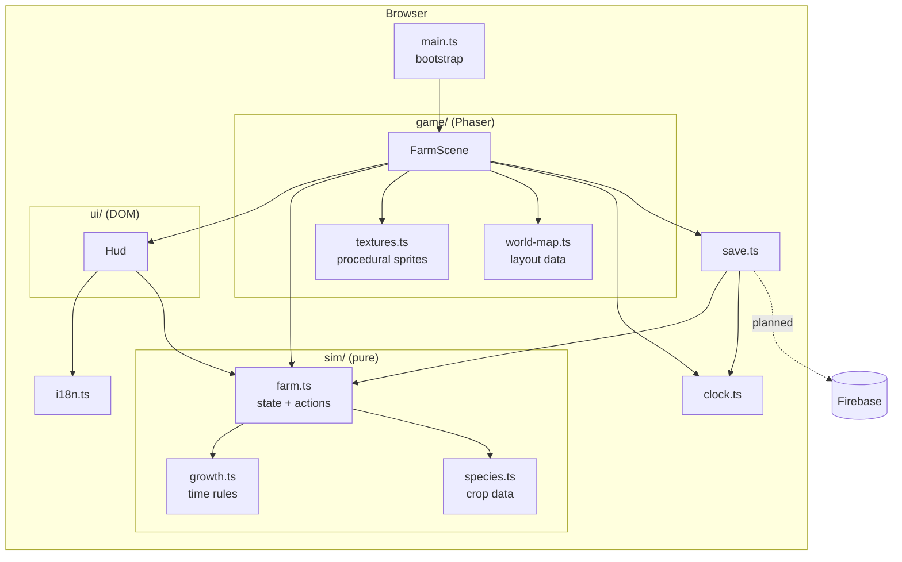

# Architecture

Vườn Chung is a single-page TypeScript app: Phaser renders the world on a canvas, a thin DOM layer draws the
HUD, and all game rules live in a pure module that knows nothing about either. This document describes the code
as it is today (wave 1, solo) and marks what is planned.



Dependencies point one way: `sim` imports nothing from the rest of the app, `ui` and `game` import `sim`, and
only `game/farm-scene.ts` wires everything together.

## Modules

### `src/sim` (pure rules)

No DOM, no Phaser, no clock, no I/O. Every action receives `now` (a millisecond timestamp) as an argument, so the
same code can run in the browser, in unit tests, and later against a shared database.

- `growth.ts`: the time model (below). Constants `HOUR`, `WATER_MS` (24 h) and `WILT_MS` (24 h).
- `species.ts`: data table for `rau_muong`, `strawberry` and `sunflower`: seed cost, hydrated time to first
  harvest (`growMs`), optional `regrowMs`, yield, sell price, XP, sprite colours. `sellPrice(id, stars)` scales
  the price by 1.0, 1.25 and 1.5 for one to three stars.
- `farm.ts`: `FarmState` (coins, xp, tilled `plots` keyed `"x,y"`, `seeds`, `produce`, shipping `bin`,
  `binDay`) and the actions `till`, `plant`, `water`, `harvest`, `ship`, `payout`, `buySeeds`. Actions mutate the
  state and return an `ActionResult` whose `msg` is an i18n key (`ok: false` carries the refusal reason).
  `migrate()` upgrades or resets a stored save by `schemaVersion`.
- `farm.test.ts`: Vitest coverage of the growth rules and the full farm loop.

### `src/game` (Phaser)

- `farm-scene.ts`: `FarmScene` builds the map, moves the farmer with arcade physics, and turns the "use" input
  into the right `sim` action for the tile being faced. It redraws soil and crop images from the state once a
  second, applies the night tint, autosaves every 15 seconds and on page unload, and pays out the shipping bin
  when the Vietnam day changes. With `#qa` in the URL it exposes `window.__qa` for tests.
- `textures.ts`: draws every 16x16 sprite procedurally into Phaser canvas textures at boot, so the repo has no
  image assets. Replacing a texture key with a sprite sheet later changes nothing else.
- `world-map.ts`: the homestead as plain data (ground tiles, props, the fenced field, spawn point) shared by the
  scene and, later, tests.

### `src/ui` (DOM HUD)

`hud.ts` owns the status bar (coins, XP, clock, bin value, language toggle), the seed hotbar, the bag, toasts, the
shop modal and the touch joystick and action button. It is DOM rather than canvas so text stays crisp and
Vietnamese diacritics render correctly. The scene tells it what changed through `render(farm, selected)`; the HUD
calls back through the `HudHandlers` interface (`onSelectSeed`, `onAction`, `onBuy`, `onLangChange`).

### `src/i18n.ts`

Two dictionaries, `vi` (primary) and `en`, with the same keys. `t(key, vars)` interpolates `{name}` placeholders
and expands `species` and `stars` specially. The chosen language persists in `localStorage` under
`vuon-chung:lang` and is mirrored to `<html lang>`.

### `src/clock.ts`

Wraps time for the whole app: `now()`, `vnHour()` (hour of day in Vietnam, UTC+7) and the dev clock. With
`?speed=N` (N > 1) time runs N times faster, starting from a persisted dev timestamp. Dev mode also selects
separate `localStorage` keys so testing never touches a real farm.

### `src/save.ts`

`loadFarm()` and `saveFarm()` read and write the `FarmState` as JSON in `localStorage` (`vuon-chung:farm`, or
`vuon-chung:farm-dev` under the dev clock). Corrupt data or blocked storage falls back to a fresh farm.

## The timestamp-derived growth model

Crops hold no countdown and nothing updates them in the background. A `Crop` is just:

```ts
{ species, plantedAt, waterings: number[], harvests }
```

Everything else is computed on read from those timestamps and the current `now`:

1. Each watering hydrates the plant for `WATER_MS` (24 h): the interval `[w, w + 24h]`.
2. Intervals are clipped to `[plantedAt, now]` and merged, so overlapping waterings never double count.
3. `hydratedMs` is the merged total; `progress = hydratedMs / growMs`, capped at 1.
4. `stage` maps progress to 0 seed, 1 sprout, 2 young, 3 mature, 4 ready.
5. `dryForMs` is the time since the last hydrated moment; more than `WILT_MS` means the plant is wilted
   (drawn drooping and tinted). Growth simply pauses while dry.
6. `qualityStars` gives one star, plus one if the longest dry gap up to the moment the plant became ready never
   exceeded `WILT_MS`. A third star is reserved for the co-op bonus (`bothHands`), which the solo build never
   sets.

Strawberries (`regrowMs` set) stay planted after harvest: `harvests` increments, `plantedAt` resets to `now`, and
only waterings still in effect are kept. The next cycle then uses `regrowMs`.

Consequences: a farm left alone for days is correct on return, there are no timers to drift or lose, tests can
pass any `now`, and two devices computing from the same stored timestamps always agree.

### Shipping bin and payout

`ship` moves produce into the bin and stamps `binDay` (the Vietnam calendar day). `payout` pays out the bin value
once `vnDay(now)` differs from `binDay`, and empties the bin in the same step, so running it twice, or from two
clients, cannot pay twice. The scene runs it at boot and on every one-second tick.

## Testing layers

- **Unit** (`src/**/*.test.ts`, Vitest): the pure `sim` rules.
- **End to end** (`tests/e2e`, Playwright): drives the real game in desktop and phone viewports through the
  `#qa` hook and the `?speed=3600` dev clock.
- **Static**: strict TypeScript, type-aware ESLint for `src`, Prettier.

## Planned: Firebase sync (not built yet)

The design keeps the door open without changing the `sim` module:

- **Auth**: Google sign-in; the world stores member UIDs only. A creator mints a one-time invite code and the
  join transaction consumes it.
- **World state**: Firestore document(s) holding the same `FarmState` shape, mutated by client transactions that
  call the same pure actions, with server timestamps for `now` and security rules that allow only the two
  members.
- **Avatars and presence**: Realtime Database for positions (a few updates per second while moving) and
  `onDisconnect` cleanup.
- **Hosting**: Firebase Hosting, deployed from GitHub Actions with workload identity federation (no long-lived
  keys). There is intentionally no deploy workflow yet.

`save.ts` is the seam: it will gain a Firestore-backed implementation next to the local one.
