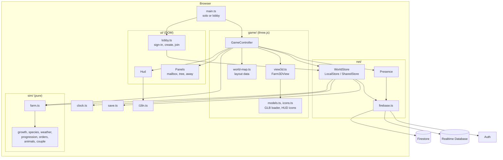
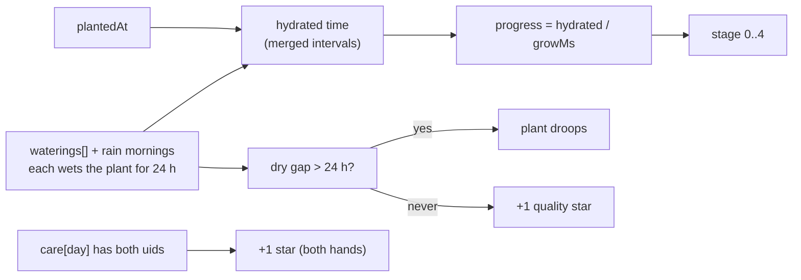
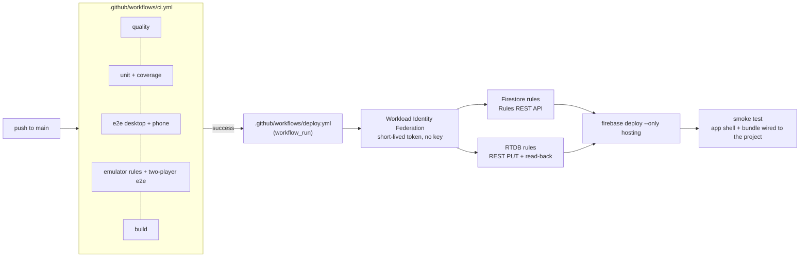

# Architecture

Vườn Chung is a single-page TypeScript app. three.js renders the world as a low-poly 3D scene on a canvas, a thin DOM layer draws the HUD
and dialogs, and every game rule lives in a pure module (`sim`) that knows nothing about either. A `WorldStore`
applies rules to the farm state, either against `localStorage` (solo) or inside Firestore transactions (shared).
Player-facing rules are in [game-design.md](./game-design.md).



Dependencies point one way: `sim` imports nothing from the rest of the app (its modules only import each other),
`ui`, `game` and `net` import `sim`, and `game/controller.ts` wires everything together.

## Module map

### `src/sim` (pure rules)

No DOM, no three.js, no clock, no I/O. Every action receives `now` (a millisecond timestamp) and, where it
matters, the acting player's `uid`, so the same code runs in the browser, in unit tests and inside a Firestore
transaction. Actions mutate the `FarmState` they are given and return an `ActionResult` whose `msg` is an i18n
key (`ok: false` carries the refusal reason).

| File             | Responsibility                                                                                                                                                                    |
| ---------------- | --------------------------------------------------------------------------------------------------------------------------------------------------------------------------------- |
| `growth.ts`      | Timestamp-derived growth: hydrated intervals, stage, wilt, quality stars. `HOUR`, `WATER_MS`, `WILT_MS`.                                                                          |
| `species.ts`     | Crop table (`rau_muong`, `strawberry`, `sunflower`, `rose`), `PRODUCTS` (egg), `sellPrice(id, stars)`.                                                                            |
| `farm.ts`        | `FarmState`, `newFarm`, `migrate`, and the actions `till`, `plant`, `water`, `harvest`, `ship`, `payout`, `buySeeds`, plus `useTile` (the single "use" decision on a field tile). |
| `weather.ts`     | Date-seeded rain: `seeded`, `isRainDay`, `rainWaterings`, `rainingAt`, Vietnam-day helpers.                                                                                       |
| `progression.ts` | Garden Heart: `LEVEL_XP`, `levelFor`, `levelProgress`, `UNLOCKS`, `isUnlocked`.                                                                                                   |
| `orders.ts`      | `ordersFor` (three daily orders), `duoFor`, `fulfill`, `deliverDuo`, `boardFor`.                                                                                                  |
| `animals.ts`     | Chickens: `buyAnimal`, `fillFeeder`, `pet`, `collectEgg`, `useAnimal`, neglect and egg quality, deterministic wandering (`animalPosition`).                                       |
| `couple.ts`      | Both-hands care (`markCare`, `tend`), letters, memories, `treeStage`, activity feed, `awaySummary`.                                                                               |

Each `*.test.ts` next to a module covers it with Vitest (`farm`, `economy`, `animals`, `couple`).

### `src/net`

| File             | Responsibility                                                                                                                                                                                                              |
| ---------------- | --------------------------------------------------------------------------------------------------------------------------------------------------------------------------------------------------------------------------- |
| `firebase.ts`    | Initialises the app. The web config is public by design; access is enforced by the rules. `?emu=1` connects Auth, Firestore and Database to the local emulators. The Firestore database is the named database `vuon-chung`. |
| `world-store.ts` | The `WorldStore` interface and its two implementations (below), plus `createWorld`, `createInvite`, `joinWithInvite`, `findMyWorld`, `syncServerClock`.                                                                     |
| `presence.ts`    | `Presence`: live pose and emote sync over Realtime Database.                                                                                                                                                                |

`LocalStore` keeps the farm in `localStorage` through `save.ts` and applies actions directly. `SharedStore`
mirrors the world document through a snapshot listener and runs each action as a transaction (see
[Transaction model](#transaction-model)). Both expose `farm`, `profiles`, `members`, `apply(action)` and
`onChange(cb)`, so the controller does not care which one it has.

### `src/game` (three.js)

- `controller.ts`: `GameController` owns input, timers and actions. It turns the "use" input into the right `sim`
  action for the tile or prop in front of you, tells the view what to draw once a second (soil, crops, rain, the
  night tint, the Memory Tree, wandering chickens, the partner avatar, emote bubbles), applies the walking-together
  speed boost, pays out the shipping bin when the Vietnam day changes, and flushes local farms every 15 seconds
  and on page unload. It never draws. With `#qa` in the URL it exposes `window.__qa` for tests.
- `view.ts`: the small `FarmView` interface the controller needs from a renderer, so rules, networking and HUD
  stay independent of how the farm is drawn.
- `view3d.ts`: `Farm3DView`, the three.js implementation: a perspective camera, soft shadows, fog, a sun that
  follows the day and night tint, and the farmer, crops, animals and props placed from the map data.
- `models.ts`: loads the CC0 Kenney GLB kits from `public/models` once, normalises each to a height in tiles
  and clones them (skeleton-aware) per use.
- `icons.ts`: renders the HUD icons from the same 3D models into small canvases.
- `world-map.ts`: the homestead as plain data (32x22 tiles, props, the fenced field `x 9-22, y 9-16`, spawn
  point, chicken pen).

### `src/ui` (DOM)

- `hud.ts`: status bar (coins, level, clock and rain icon, bin value, invite pill, language pill), seed hotbar,
  bag, toasts, shop, village board (including the duo row), emote buttons and the touch joystick and Use
  button. It is DOM rather than canvas so Vietnamese diacritics stay crisp. The controller calls `render(farm,
selected)`; the HUD calls back through the `HudHandlers` interface.
- `panels.ts`: mailbox, Memory Tree and "while you were away" dialogs. Text from the partner is inserted with
  `textContent`, never as HTML.
- `lobby.ts`: Google sign-in (popup, with a redirect fallback), then open your garden, create one (pick an
  avatar, mint an invite) or join through `?join=CODE`.

### Core modules

- `i18n.ts`: two dictionaries, `vi` (primary) and `en`, with the same keys. `t(key, vars)` interpolates
  `{name}` placeholders. The language persists in `localStorage` under `vuon-chung:lang`.
- `clock.ts`: `now()`, `vnHour()` and the dev clock. With `?speed=N` (N other than 1) time runs N times faster
  from a persisted dev timestamp and selects separate `localStorage` keys. In shared mode `setClockOffset`
  aligns the clock with the server (see [Time](#time)).
- `save.ts`: `loadFarm` and `saveFarm` for the local farm (`vuon-chung:farm`, or `vuon-chung:farm-dev` under the
  dev clock). Corrupt data or blocked storage falls back to a fresh farm.
- `main.ts`: solo mode (`?local=1` or the dev clock) starts a `LocalStore` immediately; otherwise `runLobby()`
  resolves a `SharedStore` first and `Presence` is attached.

## The timestamp-derived model

Nothing updates the farm in the background. A `Crop` is:

```ts
{ species, plantedAt, waterings: number[], harvests, care?: Record<vnDay, uid[]> }
```

Everything else is computed on read from those timestamps and `now`:



- Each watering hydrates the plant for `WATER_MS` (24 h). Intervals are clipped to `[plantedAt, now]` and merged.
- `withRain(crop, now)` adds the rain mornings (`rainWaterings`) to the watering list before any calculation.
- `stage` maps progress to 0 seed, 1 sprout, 2 young, 3 mature, 4 ready; growth pauses while dry.
- A plant dry for more than `WILT_MS` (24 h) is drawn drooping. Dryness after the plant is ready does not count.
- Strawberries (`regrowMs` set) stay planted after harvest: `harvests` increments, `plantedAt` resets and only
  waterings still in effect are kept.
- Weather, orders, chicken moods and chicken positions are likewise pure functions of the Vietnam date or the
  clock, so both players see the same thing without a server tick.

### Shipping bin and payout

`ship` moves produce into the bin and stamps `binDay`. `payout` pays the bin once `vnDay(now)` differs from
`binDay` and empties it in the same step, so running it twice, or from two clients, cannot pay twice. The controller
attempts it at most once a minute through a normal store action, so in shared mode it is a transaction.

## World document and data model

### Firestore (named database `vuon-chung`)

| Path             | Fields                                                                                                                                              |
| ---------------- | --------------------------------------------------------------------------------------------------------------------------------------------------- |
| `worlds/{id}`    | `members` (uids, max 2), `profiles` (`uid` to `{ name, look }`), `farm` (the whole `FarmState`), `createdAt`, `updatedAt`, `joinCode` (set at join) |
| `users/{uid}`    | `worldId` (your garden), `ping` (server timestamp used for clock sync)                                                                              |
| `invites/{code}` | `worldId`, `createdBy`, `partnerLook`, `expiresAt` (7 days)                                                                                         |

The world id is 20 random characters and an invite code is 26, drawn from a 32-symbol alphabet with
`crypto.getRandomValues` (about 130 bits for the code).

`FarmState` (schema version 2, `sim/farm.ts`):

| Field           | Meaning                                                                                   |
| --------------- | ----------------------------------------------------------------------------------------- |
| `coins`, `xp`   | Shared wallet and Garden Heart XP.                                                        |
| `plots`         | `"x,y"` to `{ crop? }`: tilled tiles and what grows on them.                              |
| `seeds`         | Seed counts per species.                                                                  |
| `produce`       | `"species:stars"` to count: the bag. Eggs use `egg:stars`.                                |
| `bin`, `binDay` | Shipping bin contents and the Vietnam day it was filled.                                  |
| `orders`        | `{ day, done[], xp? }`: today's completed orders; `xp` freezes the crop pool for the day. |
| `duo`           | `{ day, by[], xp }`: who has delivered their half of today's duo order.                   |
| `animals`       | Chickens: `id`, `name`, `hearts`, `pets` (today's petters), `collectedDay`, `fedDay`.     |
| `feederDay`     | Vietnam day the shared feeder was last filled.                                            |
| `letters`       | Newest first, at most 60 kept, 500 characters each.                                       |
| `memories`      | Sorted by date, at most 400, titles up to 80 characters.                                  |
| `feed`          | Activity feed, newest first, 50 kept.                                                     |

The caps keep the document well under Firestore's 1 MiB limit. `migrate()` fills missing fields from
`newFarm()` and upgrades older saves; a save written by a newer app version is left untouched (`isFromNewerApp`)
and the client reports `update_app` instead of overwriting it.

### Realtime Database

`worlds/{id}/presence/{uid}` holds `{ x, y, f, m, t, e?, et? }`: position, facing (`d u l r`), moving flag,
timestamp, and the last emote with its send time.

## Transaction model

`SharedStore.apply(action)` is the only way to change a shared farm:

1. Open `runTransaction` and read `worlds/{id}`.
2. `migrate()` the stored farm; refuse if it came from a newer app.
3. Run the pure `action(farm, now, uid)` on that freshest state.
4. If it succeeded and its message is feed-worthy, add a feed event.
5. `tx.update(ref, { farm, updatedAt: serverTimestamp() })`.

The decision to till, plant, water or harvest a tile is itself made inside the action (`useTile`), on the state
the transaction read. When two players act at once, Firestore retries the loser against the winner's result, so
two players cannot harvest the same plant or deliver the same order twice. The whole farm is one field of one
document, so simultaneous writers retry each other; with two players that is cheap. Snapshot updates from the
partner trigger a redraw through `onChange`.

Joining uses a single write batch: add yourself to `members`, add your profile and `joinCode`, delete the invite,
and write `users/{uid}`.

### Time

`syncServerClock` writes a server timestamp to `users/{uid}`, reads it back and sets a clock offset (server time
minus the midpoint of the local round trip), so both phones agree on growth and the Vietnam day even if one
device clock is wrong. The dev clock ignores the offset.

## Presence

`Presence` publishes your pose only when it changes, at most every 125 ms (about 8 per second), with a trailing
send so the resting pose always arrives. After every (re)connect it re-arms `onDisconnect().remove()` and forces a
fresh publish, because the server removed the node when the link dropped. The partner's avatar eases toward the
last reported position; emotes are a field on the same node and are shown once per `et`. Walking together
(both moving, within 24 px, hysteresis out at 36 px) gives a 1.25x speed boost.

## Security rules

`firestore.rules` (tested in `tests/rules/firestore.rules.test.ts`):

| Rule                | Summary                                                                                                                                                                                                                   |
| ------------------- | ------------------------------------------------------------------------------------------------------------------------------------------------------------------------------------------------------------------------- |
| `users/{uid}`       | Read and write only your own document.                                                                                                                                                                                    |
| `worlds/{w}` read   | Signed-in members only.                                                                                                                                                                                                   |
| `worlds/{w}` create | Signed in, `members == [you]`, and only your own profile.                                                                                                                                                                 |
| `worlds/{w}` update | Members may change the farm (it must stay a map) but never `members`; profiles stay limited to members.                                                                                                                   |
| Join                | A non-member may append themselves to a one-member world, touching only `members`, `profiles` (their own) and `joinCode`, when the invite named by `joinCode` exists for this world and has not expired.                  |
| `worlds/{w}` delete | Never.                                                                                                                                                                                                                    |
| `invites/{code}`    | `get` for any signed-in user who knows the code, `list` never, create only by a member of the target world, delete by a member of the world after the write (`getAfter`), so the joiner can consume it in the same batch. |

`database.rules.json`: anyone signed in can read `worlds/{world}/presence`; you can only write your own
`presence/{uid}` node, which must contain numeric `x` and `y`, `f` and `t`, and may only have the keys `x y f m t`
plus an `e` string of at most 8 characters and a numeric `et`.

## Testing layers

| Layer      | Where                                                          | What                                                                                |
| ---------- | -------------------------------------------------------------- | ----------------------------------------------------------------------------------- |
| Unit       | `src/sim/*.test.ts` (Vitest)                                   | The pure rules, with arbitrary `now` values.                                        |
| Rules      | `tests/rules` (`npm run test:rules`)                           | Firestore rules on the emulator: membership, join, invites, private user documents. |
| E2E solo   | `tests/e2e/solo-loop.spec.ts`                                  | Real game in desktop and phone viewports through `#qa` and the `?speed=3600` clock. |
| E2E shared | `tests/e2e/shared-two-players.spec.ts` (`npm run test:shared`) | Two browser contexts on the Auth, Firestore and Database emulators.                 |
| Static     | CI `quality` job                                               | Strict TypeScript, type-aware ESLint, Prettier.                                     |

## Deploy pipeline



- Other workflows: `codeql.yml`, `dependency-review.yml`, `secret-scan.yml` (gitleaks).
- `deploy.yml` runs only after a successful CI run for a push to `main` (or by manual dispatch), in the
  `production` environment, with one deploy at a time.
- Authentication is Workload Identity Federation: no service-account key is stored.
- Firestore rules go through the Rules REST API (create a ruleset, delete the release, recreate it), because
  `firebase-tools` silently skips rules deploys to a named Firestore database under these credentials.
- Realtime Database rules are written through the REST API and then read back and compared, so a silent no-op
  fails the job.
- The smoke test checks content rather than status codes, since the SPA rewrite returns 200 for any path.

## Known trade-offs

- **Trusted two-player, not cheat-proof.** The client runs the game rules and writes the whole farm. The rules
  verify membership and that `farm` is a map, not that the numbers are legal, so a member with devtools could
  write any state. That is acceptable for two people who trust each other and keeps the backend at zero
  servers.
- **Presence is readable by signed-in users who know the world id.** The Realtime Database rule is
  `auth != null` on read. The world id is a 100-bit random string that the UI never shows, but anyone who learns it
  could read positions and emotes (not the farm, which is protected by Firestore membership).
- **An invite link is a capability.** Anyone signed in with an unexpired, unused link can join a one-member
  garden. Links are one-time, expire after 7 days and cannot be listed.
- **One document per garden.** Simultaneous writes retry each other, and the document has a 1 MiB ceiling,
  which is why letters, memories and the feed are capped.
- **The Firebase web config is in the source.** That is normal for web apps; security comes from the rules.
